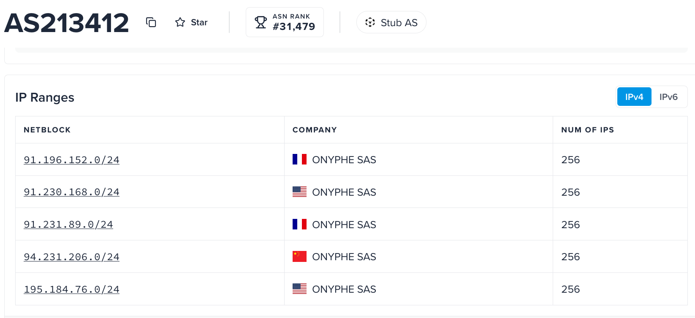

# Internet based scanning orgs
List of IPs belonging to common internet-wide scanning organizations.

### Stretchoid

Stretchoid is an internet-wide reconnaissance and port-scanning platform - not a malicious botnet. It  uses rotating 
IP addresses—frequently hosted on cloud providers like Microsoft Azure or DigitalOcean - and they don't disclose what 
CIDRs they use, so monitoring them is tricky. I update my lsit peridically depending on how many new IPs my Palo 
catches in one of its rulesets.

They do have an [opt-out page](https://stretchoid.com/) for anyone who thinks they'll stop. My list is composed of IPs I gathered 
from my own Palo logs and may be incomplete.

### Vision Height

They run a controlled, ethical internet scanning program across the public IPv4 address space to collect 
public service metadata, banner information, and TLS certificates, according to [their web site].  
They also have [an opt-out email address](optout@visionheight.com).

  

### Deepfield

### Shadow Server.io
One thing that bugs me about Shadow Server after reading their site is that they scan for vulnerabilities and then
regularly publish the results in a newsletter anyone can sigh up for. Thanks?!

FAQ = https://www.shadowserver.org/common-questions/
Optout = dnsscan@shadowserver.org

#### Common Shadowserver Scanner IP Ranges and Subnets
Reverse-DNS hostnames should match 'scan-*.shadowserver.org' or 'shadowserver.io' and the Internet says they use 
CIDRs from [ASN22168](https://ipinfo.io/AS22168) for The Shadowserver Foundation but might also be using ranges from
[Hurricane Electric ASN6939](https://bgp.he.net/AS6939).

The EDL I have comes from scans on my own firewall and match up closely to [this list on Gihub](https://github.com/Connie-Wild/scanner-ip-list/blob/main/shadowserver.txt)
but there's also a more extensive list, and more recent, on [Github here](https://github.com/MikeCaldera/security/blob/main/shadowserver.txt).
I've not, as of today, compared the newer list to AS22168.

### Driftnet LTD 
#### Manchester, United Kingdom

Cool name, huhn? Driftnet Ltd operates internet-measurement and research scanners associated with the 
ASN AS211298. According to their web site they are a "cloud-based technology company that specializes in 
network asset discovery and continuous attack surface management solutions". To op out of their scanning, send an email 
to optout@driftnet.io. 

Recently acquired by a similar company called [SecurityScorecard](https://securityscorecard.com/company/press/securityscorecard-acquires-driftnet-to-power-real-time-threat-informed-third-party-risk-management/).

### Infrawat.ch

An internet-wide intelligence and scanning platform that maps public-facing hosts, residential proxies, VPN endpoints, and adversary infrastructure (such as Cobalt Strike or EvilNginx) in real time.

Hostname Pattern: *.monitoring.internet-measurement.com

opt-out@infrawat.ch

### Modat.io

Research

https://scanner.modat.io/ipv4.txt

### Censys

From the [Censys website](https://docs.censys.com/docs/internet-scanning) info page about what they scan, and for what purpose. They also list their IP space [IPv4 and IPv6](https://docs.censys.com/docs/opt-out-of-data-collection#allowlist-or-blocklist-scans) as well as their AS numbers.

Censys continually scans the entire public IPv4 address space using automatic protocol detection, examining all possible IP and port combinations. The results accurately represent the Internet’s current state.

Censys also leverages redirects and the Domain Name System to discover and scan in-use IPv6 addresses.
Scan frequency

Discovery means finding a service on an IP/port that was not there the last time Censys looked. Censys continuously scans for discovery using the following methods.

    Global scan of popular ports. Censys continually and rapidly scans the whole IPv4 space on over 100 ports with 
    Internet Assigned Numbers Authority (IANA-assigned) services.
    Cloud provider scans. Our docket of cloud services contains a list of IPs and common ports for AWS, Azure, 
    and GCP cloud hosting providers. It is optimized to scan each item at least once daily, sometimes more. 
    Using current and historical data from the services on this docket and other data in our dataset, Censys 
    continuously generates dynamic scanning targets.

### Onyphe.io 
#### France

Another commercial purveyor of 'threat intellignce services". Network administrators or security teams wanting to 
report abuse or request exclusions can contact abuse@onyphe.io or contact@onyphe.io.'

The subnets from AS213412 match up closely with the last dump of their IPs I generated.

### Onlyscans.com
#### Boston, MA

OnlyScans uses reverse DNS (PTR) records ending in *.scanners.onlyscans.net to identify its scanning IP addresses.
The internet says the use data center networks across multiple global regions (including the US, Japan, and India).
Very minimalist [web presence](https://onlyscans.com/about).

### Internet Census Scanner 
#### Boston, MA
https://www.internet-census.org/

Parent company is [Bitsight.com](https://www.bitsight.com/) out of Boston, MA.

optout@internet-census.org

They seem to operate primarily under AS211680 [(NSEC - Sistemas Informaticos, S.A., also associated with AS-BITSIGHT)](https://ipinfo.io/AS211680)
which lists four blocks of IPs from the US and Netherlands.

They don't list their IPs and helpfully suggest that you do a reverse DNS lookup yourself - you would be 
looking for '*.internet-census.org'. My additional list in this folder show a current log grab with their IPs
and host names. Most of them match up with what's published in their AS, but not all of them.

