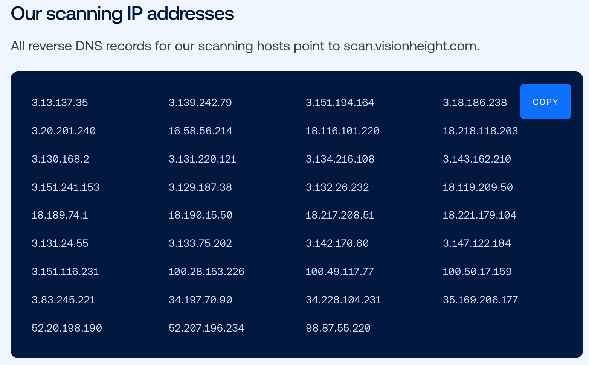

# Internet based scanning orgs
List of IPs belonging to common internet-wide scanning organizations.

The data is provided in the following formats:
- nftables
- cidr

### Stretchoid

Stretchoid is an internet-wide reconnaissance and port-scanning platform rather than a malicious botnet. It operates using rotating IP addresses—frequently hosted on cloud providers like Microsoft Azure or DigitalOcean. They do have an [opt-out page](https://stretchoid.com/) for anyone who thinks they'll stop. My list is composed of IPs I gathered from my own Palo logs and may be incomplete.

### Vision Height

They run a controlled, ethical internet scanning program across the public IPv4 address space to collect public service metadata, banner information, and TLS certificates, according to [their web site].  They also have [an opt-out email address](optout@visionheight.com).

  [(https://www.visionheight.com/scan#ips)]

### Infrawat.ch

An internet-wide intelligence and scanning platform that maps public-facing hosts, residential proxies, VPN endpoints, and adversary infrastructure (such as Cobalt Strike or EvilNginx) in real time.

### Censys

From the [Censys website](https://docs.censys.com/docs/internet-scanning) info page about what they scan, and for what purpose. They also list their IP space [IPv4 and IPv6](https://docs.censys.com/docs/opt-out-of-data-collection#allowlist-or-blocklist-scans) as well as their AS numbers.

Censys continually scans the entire public IPv4 address space using automatic protocol detection, examining all possible IP and port combinations. The results accurately represent the Internet’s current state.

Censys also leverages redirects and the Domain Name System to discover and scan in-use IPv6 addresses.
Scan frequency

Discovery means finding a service on an IP/port that was not there the last time Censys looked. Censys continuously scans for discovery using the following methods.

    Global scan of popular ports. Censys continually and rapidly scans the whole IPv4 space on over 100 ports with Internet Assigned Numbers Authority (IANA-assigned) services.
    Cloud provider scans. Our docket of cloud services contains a list of IPs and common ports for AWS, Azure, and GCP cloud hosting providers. It is optimized to scan each item at least once daily, sometimes more. Using current and historical data from the services on this docket and other data in our dataset, Censys continuously generates dynamic scanning targets.
    Predictive scanning engine. Using both the current and historical data from the services found via Global and Cloud Provider scans, Censys generates dynamic scanning targets on a continual basis using the Predictive Scanning engine. The methods described above essentially act as seeds as the input to this engine which can be used to more accurately find and predict the best possible IPs and ports to scan. Predictive scanning accounts for over 40% of all services Censys finds on the Internet today. For more information on how Predictive Scanning works, see the Censys blog: Raising the Bar on Internet Coverage: Predictive Scanning Takes The Censys Internet Map to the Next Level.
    IPv4 Internet scan. Censys continuously scans all 65,535 ports on the IPv4 Internet with a port walk to gather as much background information as possible across all possible IP and port combinations.

